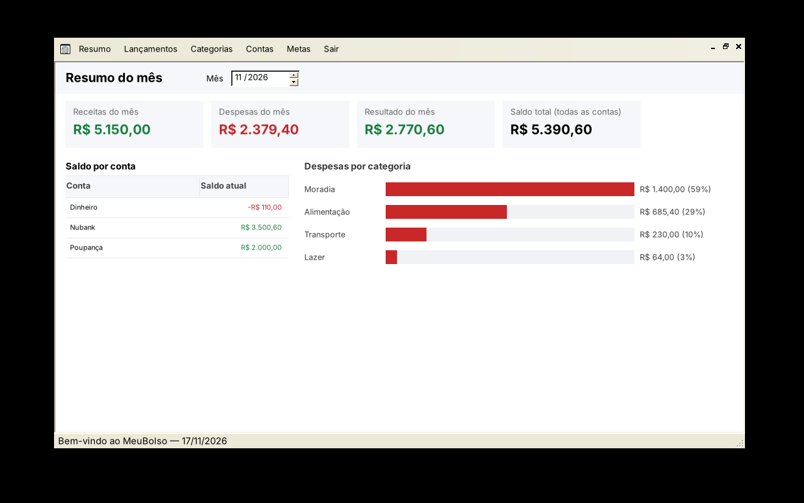
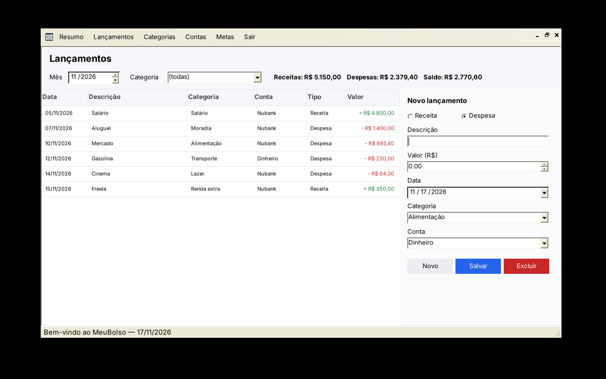
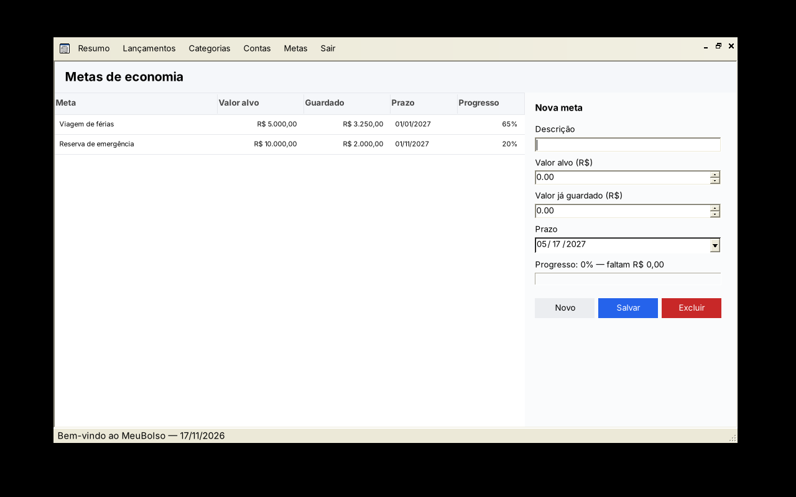

# MeuBolso — Controle Financeiro Pessoal

Projeto final da disciplina **Programação Orientada a Objetos I**.
Sistema desktop em **C# / Windows Forms (.NET 8)** para controlar receitas, despesas, contas e metas de economia.



## Como executar

1. Instale o **Visual Studio 2022** com a carga de trabalho **"Desenvolvimento para desktop com .NET"**.
2. Abra o arquivo `MeuBolso.sln`.
3. Pressione **F5**.

Na primeira execução o banco é criado automaticamente, já com dados de exemplo.

## Requisitos do trabalho

| Requisito | Como foi atendido |
|---|---|
| Interface gráfica em C# | Windows Forms (.NET 8) |
| Versionamento no Git | Este repositório (código, imagens em `docs/telas` e script `database/meubolso.sql`) |
| CRUD | Criar, consultar, editar e excluir em Categorias, Contas, Lançamentos e Metas |
| Menu com no mínimo 4 itens, cada um abrindo uma tela | Menu com 5 telas: Resumo, Lançamentos, Categorias, Contas e Metas |

## Telas

| Tela | O que faz |
|---|---|
| **Resumo** | Receitas, despesas e resultado do mês, saldo por conta e gráfico de despesas por categoria |
| **Lançamentos** | CRUD de receitas e despesas, com filtro por mês e categoria |
| **Categorias** | CRUD de categorias (tipo Receita ou Despesa) |
| **Contas** | CRUD de contas/carteiras, com saldo inicial e saldo atual calculado |
| **Metas** | CRUD de metas de economia, com barra de progresso |

| Lançamentos | Metas |
|---|---|
|  |  |

## Estrutura do projeto

```
database/
└── meubolso.sql   → script do banco (tabelas + dados de exemplo)
MeuBolso/
├── Models/        → classes de domínio (POO)
│   ├── Entidade.cs        classe base abstrata (Id)
│   ├── Lancamento.cs      classe ABSTRATA
│   ├── Receita.cs         herda de Lancamento
│   ├── Despesa.cs         herda de Lancamento
│   ├── Categoria.cs, Conta.cs, Meta.cs
│   └── TipoLancamento.cs  enum
├── Data/          → acesso a dados
│   ├── IRepositorio.cs        interface genérica do CRUD
│   ├── RepositorioSqlite.cs   CRUD genérico em SQLite (abstrata)
│   ├── Repositorios.cs        um repositório por tabela
│   ├── RepositorioMemoria.cs  versão em memória (para testes)
│   ├── Database.cs            conexão e criação do banco
│   └── Contexto.cs            ponto único de acesso aos repositórios
├── Services/
│   └── FinanceiroService.cs   cálculos e regras de negócio
└── Forms/         → telas (cada uma com .cs + .Designer.cs)
```

## Conceitos de POO aplicados

- **Encapsulamento:** propriedades com validação no `set` (ex.: `Valor` não aceita zero ou negativo, `Nome` não aceita vazio).
- **Herança:** `Receita` e `Despesa` herdam de `Lancamento`, e todas as entidades herdam de `Entidade`.
- **Abstração:** `Lancamento` e `Entidade` são classes abstratas, então não dá para criar um "lançamento genérico".
- **Polimorfismo:** `ValorComSinal()` é sobrescrito, positivo na Receita e negativo na Despesa. O saldo da conta soma tudo sem precisar de `if`.
- **Interface e genéricos:** `IRepositorio<T>` define o CRUD para qualquer entidade, e as telas dependem só da interface.
- **Fábrica:** `Lancamento.Criar(tipo)` devolve a classe filha correta.

## Banco de dados

O sistema usa **SQLite**, um banco que fica num único arquivo (`meubolso.db`) e roda dentro do próprio programa, sem precisar instalar servidor.

- **Script:** [`database/meubolso.sql`](database/meubolso.sql) cria as tabelas (`categorias`, `contas`, `lancamentos`, `metas`) e insere os dados de exemplo.
- **Primeira execução:** o programa percebe que o banco está vazio, executa esse script e cria o `meubolso.db` ao lado do `.exe` (`MeuBolso/bin/Debug/net8.0-windows/`). O caminho aparece na barra de status.
- **Zerar os dados:** feche o programa e apague o `meubolso.db`. Na próxima execução ele é recriado com os dados de exemplo.
- **Ver as tabelas:** abra o `meubolso.db` no [DB Browser for SQLite](https://sqlitebrowser.org/).
- **Biblioteca:** `Microsoft.Data.Sqlite` (NuGet), que o Visual Studio baixa sozinho ao compilar.

### Como o código acessa o banco

```
IRepositorio<T>                 ← interface do CRUD (as telas só conhecem ela)
 ├── RepositorioMemoria<T>      ← versão em memória (para testes)
 └── RepositorioSqlite<T>       ← CRUD genérico em SQL (abstrata)
      ├── RepositorioCategorias
      ├── RepositorioContas
      ├── RepositorioLancamentos   ← lê a coluna "tipo" e cria Receita ou Despesa
      └── RepositorioMetas
```

`RepositorioSqlite<T>` escreve o `INSERT`, `SELECT`, `UPDATE` e `DELETE` uma única vez. Cada filha só informa o nome da tabela e como converter linha ↔ objeto (padrão *Template Method*).
Todos os comandos usam **parâmetros** (`@nome`), o que protege contra SQL Injection.

## Integrantes

- Thiago Oliveira Franco - RA 125119
